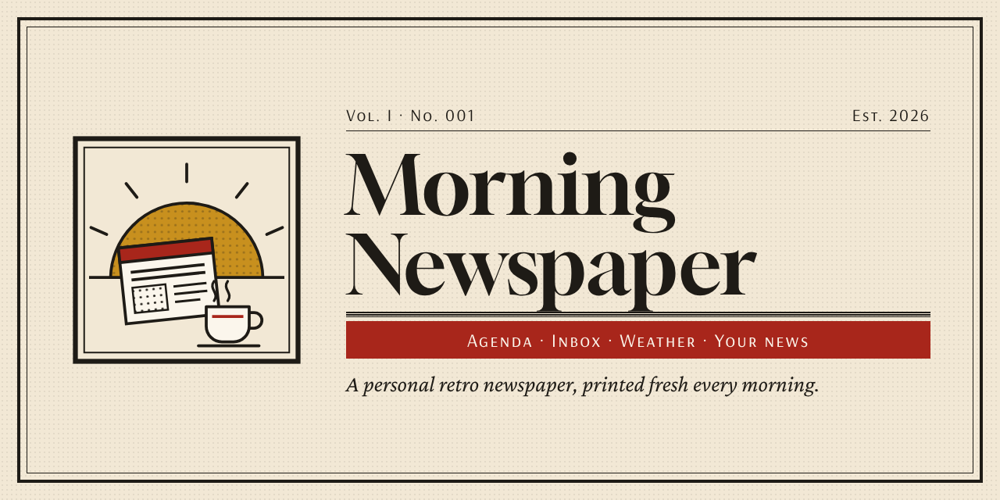
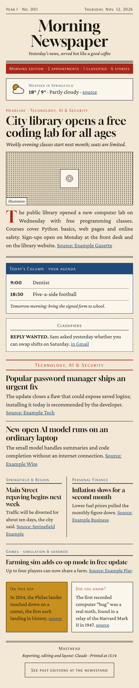

<p align="center"></p>

# Morning Newspaper

A Claude skill that delivers a **personal retro morning newspaper**: your agenda, the emails waiting for your reply, the weather and the news you care about, laid out like a 1980s–90s printed daily. Every edition is kept at a private **newsstand** page, so you can flip back through past days.

The default name follows your language (**Morning Newspaper** in English, **O Jornal Matinal** in Portuguese, **El Diario Matinal** in Spanish). Rename it to anything you like during setup.

<p align="center"></p>

## Features

- **Speaks your language.** The repository is in English, but the newspaper, the setup questions and Claude's replies follow the reader's language. English, Brazilian Portuguese and Spanish labels ship with the skill. For any other language, Claude translates the labels during setup.
- **Your sections, your sources.** Technology, local news, finance, games or anything else. Each section has its own search queries, optional RSS feeds and a layout (wide, half-width pair or single box).
- **Today's Column and Classifieds.** Pulls today's events from Google Calendar and the emails that are still waiting for an answer from Gmail.
- **Weather, "On this day" and "Did you know?"**, all checked against a source.
- **Cheap to run.** Two small Python scripts do the heavy lifting: news gathering through RSS, weather, history facts, HTML building, newsstand index and checks. Claude only reads a compact summary, picks the stories and writes a short JSON. An edition costs roughly a third of what a do-everything-by-hand prompt would.
- **Safe by design.** Read-only GET requests to public sources. Everything collected is treated as data, never as instructions. It never sends email or edits your calendar. Personal money and health details never reach the page. Your newsstand stays private.

## Install (claude.ai or the Claude apps)

1. Download [`dist/morning-newspaper.zip`](dist/morning-newspaper.zip). Do not unzip it.
2. In Claude, open **Customize → Skills**, click **+ → Create skill → Upload a skill**, and choose the zip.
3. Make sure the skill is switched on.

**Updating:** delete the old `morning-newspaper` skill and upload the new zip as a *new* skill. The "Replace" screen can fail with a generic upload error.

Connect **Google Calendar** and **Gmail** if you want the agenda and the classifieds. Without them, those boxes are left out.

## First run

Ask Claude for *"my morning newspaper"* (in any language). On the first run it asks up to five quick questions:
1. your name,
2. your city,
3. your topics,
4. the newspaper's name,
5. the time you want it ready.

It then publishes edition No. 001 together with your newsstand and offers to schedule a daily edition.

Your answers are saved as `config.json` **inside your private newsstand**, never in this repository. See [`references/config.example.json`](morning-newspaper/references/config.example.json) for the format.

### Daily schedule and approvals

A scheduled run happens while you sleep, so nobody is there to approve tool calls. Turn on automatic approval in the scheduled task's settings (if your organization allows it). For extra safety, you can also set only the read tools (Calendar list, Gmail search/read) to "always allow" in your connector settings. Details: [`references/permissions.md`](morning-newspaper/references/permissions.md).

## Repository layout

```
morning-newspaper/            the skill (this folder is what goes in the zip)
  SKILL.md                    main instructions
  scripts/collect.py          news (Google News RSS + feeds), weather, "On this day"
  scripts/assemble.py         builds the edition HTML and updates the newsstand index
  references/                 setup, writing rules, JSON format, newsstand, style, permissions
  assets/edition.html         edition template
  assets/archive.html         newsstand page
  assets/i18n/*.json          UI labels (en, pt-BR, es)
dist/morning-newspaper.zip    ready-to-upload skill
build-zip.sh                  rebuilds the zip
docs/example.png              screenshot with fictional content
docs/brand/                   banner, logo and emblem (SVG)
```

## Contributing

- Add a language: copy `morning-newspaper/assets/i18n/en.json` to `<code>.json` and translate the values. Keep the `{placeholders}` and the order of weekdays (Monday first) and months.
- After changing the skill, run `./build-zip.sh` so `dist/` stays in sync.
- Never commit a real `config.json`, edition or newsstand index: they contain personal data. `.gitignore` already blocks them.

The scripts use only the Python standard library.

## License

[MIT](LICENSE)
